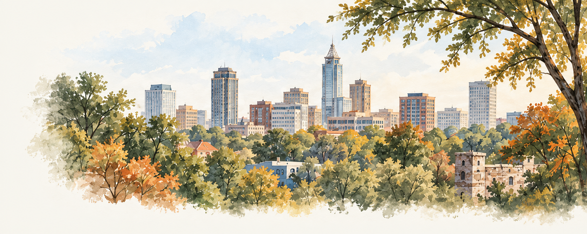

# Raleigh, together

An itinerary for a pediatric dental oral boards trip to Raleigh, October 2–6, 2026, with study breaks, maps, exam logistics, and a printable recap. The trip has passed; see the [roadmap](ROADMAP.md) for archive and reuse priorities.



_The watercolor is an illustrative trip asset, not a documentary photograph or live map._

Study content lives in [Oral Boards](https://oral-boards.vercel.app/study); legacy `/study` URLs permanently redirect there.

## Run locally

Use the Node version in `.node-version` and pnpm version in `package.json`.

```bash
pnpm install --frozen-lockfile
pnpm dev
```

Open the URL printed by [Portless](https://github.com/vercel-labs/portless): `https://raleigh-travel.localhost` in the main checkout, with a branch subdomain in linked worktrees. Its first run may ask for `sudo` to bind port 443 and trust a local certificate.

No environment variables are required. The map uses OpenStreetMap tiles by default; optional `NEXT_PUBLIC_CARTO_KEY` selects CARTO Voyager tiles. Weather uses the server's `/api/weather` route and Open-Meteo, so a static export alone cannot serve it. Past trip dates have no live forecast.

## Checks and build

```bash
pnpm check
pnpm build
```

`pnpm check` includes formatting, lint, types, and offline tests. To run tests alone and exit, use `pnpm test:run`; `pnpm test` watches for changes.

## Editorial limits

The initial source review was September 23, 2026; some itinerary entries record later checks. Outings, meals, transfers, and study blocks are suggestions, not bookings. Reconfirm date-specific information before reusing the plan; the latest ABPD candidate communication takes precedence over the itinerary.

Keep personal names, reservation and ticket identifiers, payment details, and private mailbox links out of public copies. Search-engine indexing is disabled; the site has no authentication.

The watercolor asset in `public/raleigh-watercolor.png` was created with the built-in image generation tool. Official ABPD, AAPD, and Vimeo material is linked rather than redistributed.
